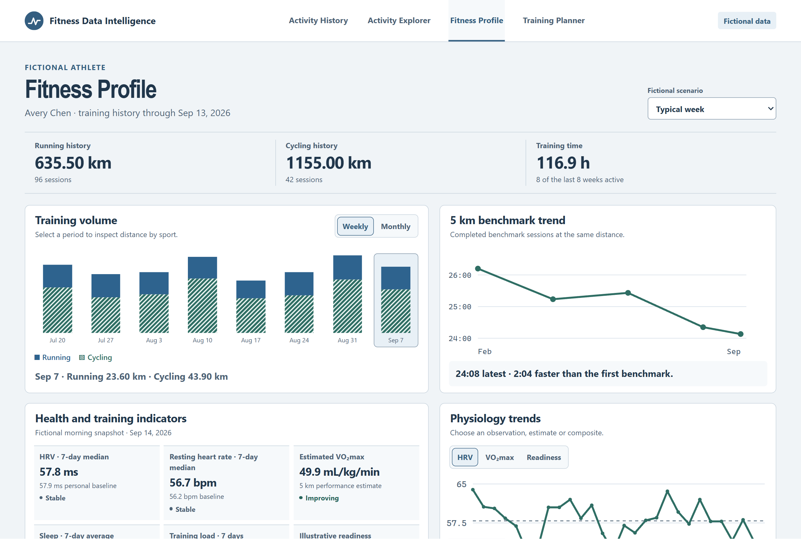
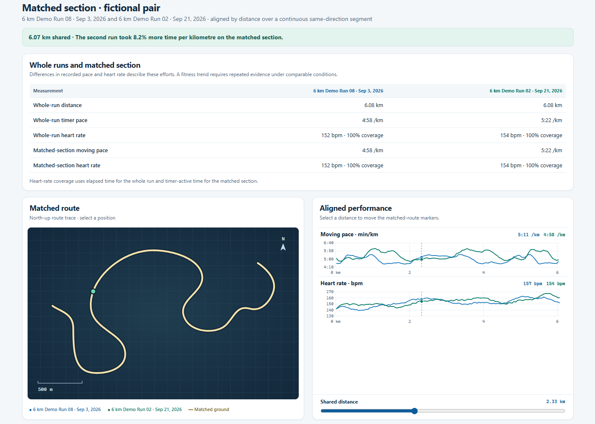
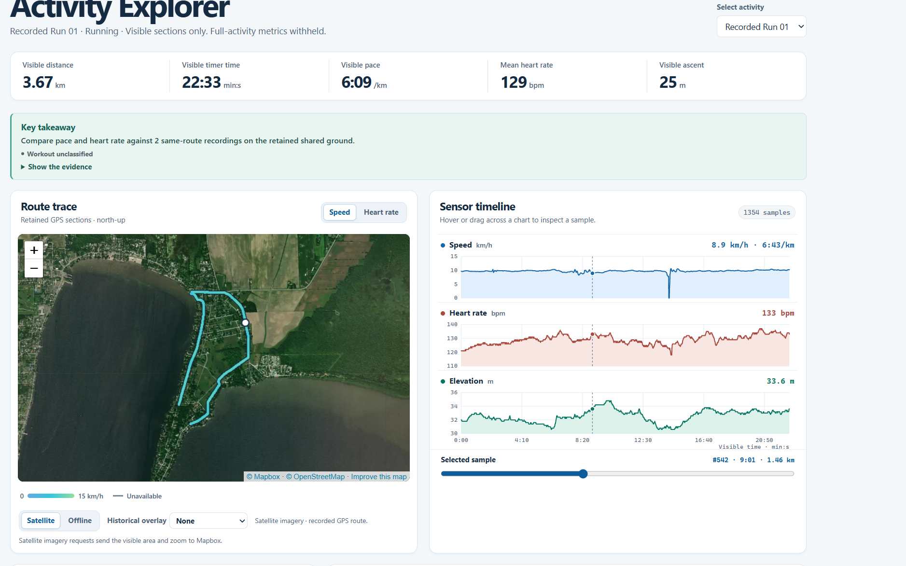
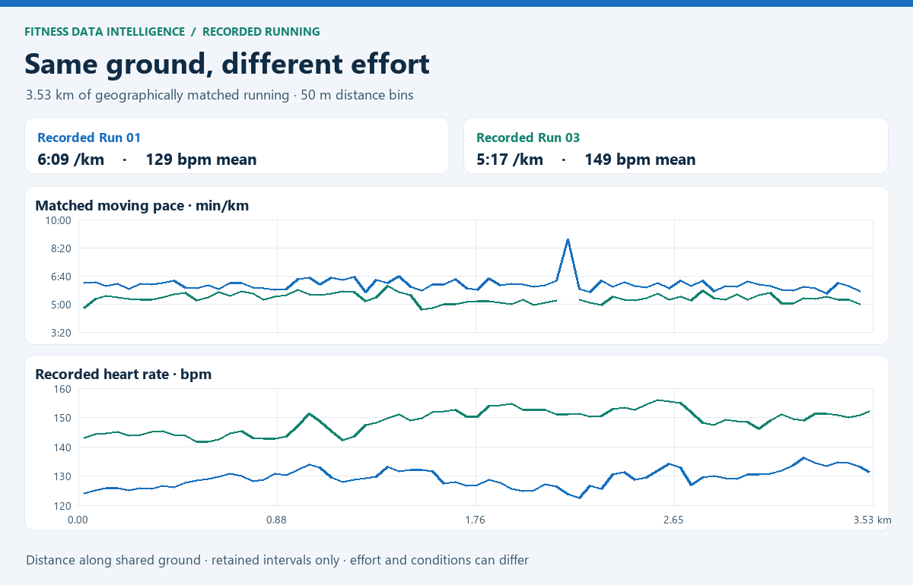
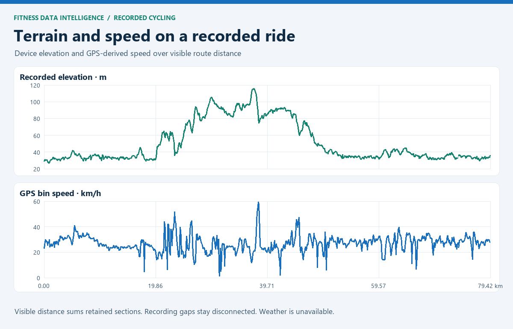

# Fitness Data Intelligence

I built Fitness Data Intelligence as an avid runner and cyclist with an engineer's curiosity about data. After a run or ride, I kept asking questions that a workout summary could not readily answer: Was I genuinely faster over the same ground? Could heat, wind, or terrain explain part of a difficult effort? What does my own training history suggest about my current fitness, and how should I train over the next week to progress toward a particular goal?

My aim is not to replace Garmin Connect or Strava, but to **extract more insight from the data they help record**. The approach combines wearable measurements with external environmental observations, identifies legitimately comparable runs through shared route geometry, and interprets individual efforts against personal trends accumulated over weeks, months, and years. The broader project also envisions an evidence-grounded large language model (LLM) that can synthesize quantitative findings and relevant exercise-science research into understandable explanations, acknowledge uncertainty, and help inform future training recommendations. The central questions are not only **what happened**, but **why performance might differ, where my fitness stands today, and what to do next**.

**Portfolio scope.** Fitness Data Intelligence is an independently implemented engineering demonstration of selected ideas from my larger, privately developed *Spatial Fitness Intelligence* project. The public app uses deterministic fictional activities and a fictional 36-week athlete history. Its key takeaways and training suggestions come from explicit rules tied to their inputs, not a live LLM. Genuine Garmin measurements appear in this README as privacy-trimmed, flattened media.


*The interactive public demo uses independently generated fictional activities. The recorded-Garmin figures further below demonstrate the real-data pipeline using previously reviewed, flattened imagery; raw locations and FIT recordings are not distributed.*

## Explore the fictional demo

Start in **Activity History**, open **6 km Demo Run 08**, and choose **6 km Demo Run 02** in Explorer to compare the two. To follow a planning decision back to its inputs, open **Training Planner** and expand **Load and readiness**.

### Activity History

**Purpose.** Activity History is the central record of an athlete's running and cycling sessions. It makes a growing archive manageable and helps identify which workout deserves closer inspection—whether that is a familiar route, a recent hard effort, or a session at a comparable distance.

**How it works.** The activity index exposes distance, time, pace or speed, heart rate, and ascent alongside sport filters and sorting controls. Selecting a session opens Activity Explorer for detailed analysis. The deeper comparison logic then looks beyond names and total distance to distinguish genuinely shared running routes; the selected activity is excluded from its own historical reference.


### Activity Explorer

**Purpose.** Activity Explorer asks what actually happened *during* a particular effort, how that effort compares with my own relevant history, and which conditions might help explain differences. Instead of treating average pace or heart rate as the whole story, it links performance to location, time, and context.

**How it works.** A route marker and synchronized speed, heart-rate, and elevation timelines let the user inspect the same recorded moment across multiple signals. Quality checks identify pauses, GPS gaps, and incomplete sensor coverage. For running, spatial matching finds continuous, same-direction ground shared with earlier activities, enabling distance-aligned pace and heart-rate comparisons rather than misleading comparisons based only on total kilometres. For cycling, climb analysis and direction-relative wind components can add environmental context where suitable source data exists. A concise **Key takeaway** translates the available evidence into plain language; in this public demo it is produced by transparent deterministic rules, while richer LLM-assisted interpretation is part of the broader project vision. The public cycling weather scenario is fictional, and the recorded ride does not have verified historical weather.


### Fitness Profile

**Purpose.** Fitness Profile moves from individual activities to the longer-term question: *Where does my fitness appear to stand now, relative to my own history, and how is it changing?* It brings performance progression, training consistency, and recovery-related context into one view instead of requiring the athlete to interpret many separate metrics.

**How it works.** A fictional 36-week athlete history supplies repeat 5 km benchmarks, running and cycling volume, and personal records. Recent heart-rate variability (HRV), resting heart rate, sleep, and accumulated training load are evaluated against the athlete's own preceding reference periods, rather than presented as isolated readings. An illustrative readiness composite and evidence-linked **Key takeaway** summarize the main signals while leaving the supporting trends visible. These demo calculations are deterministic and the readiness score is not clinically validated; a future LLM interpretation layer is an ambition of the broader product, not a capability of this page today.



### Training Planner

**Purpose.** Training Planner explores the next step: *How can the insights from my recent and long-term fitness history inform what I should do over roughly the next seven days?* The broader aim is goal-aware planning that considers personal trends, recovery, constraints, and relevant exercise-science research—not simply a generic training schedule. This part of the larger product is still evolving.

**How it works.** The public demonstration uses an explicit, inspectable rule set. It starts from recent running volume and the four-week median, considers illustrative readiness and training load, and proposes a week of running and cycling. If load is high or readiness low, it reduces the running budget and omits the controlled effort; the **Lighter** option reduces the starting budget by a further 25%. Its **Key takeaway** and expandable evidence sections show why the suggested week changes. In the broader product, the intent is to cross-reference established exercise-science literature with the individual's longitudinal data and use an LLM to explain evidence and trade-offs—not to let an LLM invent training prescriptions or imply scientifically validated outcomes.


## 6 km matched-route comparison · fictional runs

Two runs can each total 6 km while covering different climbs, approaches, or sides of an out-and-back. The matcher looks for a continuous stretch where nearby positions follow the same direction and both runners advance along the route. It aligns pace and heart rate by distance on that stretch, keeping whole-run summaries separate.

In the example below, **6 km Demo Run 08** and **6 km Demo Run 02** share **6.07 km**. Run 02 takes 8.2% more time per kilometre on that ground. Move the shared-distance slider to see where the pace difference opens or closes and whether the two heart-rate traces diverge there too. Comparable terrain makes the observation easier to interpret. Effort and conditions can still differ.



## Recorded Garmin examples

Real recordings test the method against uneven sampling, GPS uncertainty, and genuine changes in speed and heart rate. The running examples below show only retained sections after the owner-selected 500 m endpoint mask; displayed running times and distances refer to the visible or matched ground. The complete cycling recording is available only in the optional private local review.

**Running on satellite imagery.** Recorded Run 01 retains 3.67 km. The selected sample locates a moment on the road and the same moment in all three timelines. The replay follows the observed signals through the run and then switches to distance along a matched section. [Recorded sensor replay](docs/media/recorded-sensor-replay.gif)



**3.53 km matched comparison · recorded runs.** Measured along Recorded Run 01, the two runs share 3.53 km. On that section, Run 01 averaged 6:09/km at 129 bpm and Run 03 averaged 5:17/km at 149 bpm. The pace difference persists across much of the section, as does the higher heart rate on the faster run. Establishing a fitness trend would require repeated evidence under comparable conditions.



**Cycling over changing terrain.** This previously captured graph aligns device elevation and GPS-derived speed across a 79.42 km retained section of a ride. The current opt-in local Garmin review additionally supports the owner-approved **complete 82.73 km cycling recording**, including its satellite route and recorded ascent; no raw cycling track is published. The climb and descent give speed changes a physical reference. Historical weather has not been verified for the published figure, so it cannot establish a wind effect.



## Methods, limits, and privacy

- **Measurement quality.** The FIT reader checks file integrity, decodes the session, records, and timer events, and identifies unusable samples. Heart-rate means are weighted by time between adjacent valid readings. GPS gaps, pauses, and implausible jumps limit which intervals can contribute to a comparison. [Data methods](docs/data-methods.md)
- **Spatial alignment.** The matcher tests proximity, direction, and forward progress on continuous route sections. Matched pace uses each run’s timer-active time over a common reference distance. Close parallel roads or repeated passes can still be ambiguous. Short grades are sensitive to elevation noise, and projected wind cannot account for shelter, gusts, or rider effort. [Running and cycling methods](docs/comparative-methods.md)
- **Athlete interpretation.** Training load uses session minutes multiplied by a session rating of perceived exertion. HRV, resting heart rate, sleep, and completed load feed a deterministic readiness score with illustrative weights. The score has no clinical validation. The suggested week illustrates a decision rule and carries no prediction of training response. [Health and planning methods](docs/health-methods.md) · [Evidence and classification rules](docs/semantic-methods.md)

The interactive application and its JSON and CSV exports use independently generated fictional data. For recorded media, local preprocessing excludes **every visit within 500 m of any selected activity’s original start or finish**, checks connecting edges, and trims farther along the surviving sections. Removed sections stay disconnected. Original endpoints, dates, full-activity totals, raw FIT files, recorded coordinate arrays, and recorded API payloads remain private. The only public representations of the recordings are flattened images and animations. Familiar terrain and repeated approaches may still identify a location. Trimming cannot guarantee anonymity.

## Run locally

Use Python 3.12 or newer and a current browser. The public application requires no third-party packages.

```powershell
python app.py
```

Open <http://127.0.0.1:8000/>. Use `python app.py serve --port 8001` to change the port. Stop the server with `Ctrl+C`.

To validate the recorded GPS/satellite view privately on your own computer, follow the [opt-in local recorded Garmin preview](docs/local-recorded-preview.md). The standard public demo does not load private FIT files or a live satellite map.

## Test and inspect the code

```powershell
python -m unittest discover -s tests -v
node --test tests/test_route_map.mjs tests/test_comparison_map.mjs
python app.py export --output artifacts/exports
```

| Component | Responsibility |
| --- | --- |
| `synthetic_data.py`, `analysis_core.py` | Reproducible activities, sample validation, splits, and summaries |
| `geography.py`, `comparative.py`, `environmental.py` | Route alignment, aligned signals, and terrain and weather context |
| `fit_reader.py`, `private_preview.py` | Selected FIT decoding and in-memory normalization |
| `portfolio.py`, `athlete.py`, `health.py` | Activity history, peer selection, and fictional training analysis |
| `app.py`, `web/` | Loopback HTTP, exports, and browser-native visualizations |

[Synthetic media capture and browser checks](tools/capture_portfolio.mjs) · [Portfolio roadmap](docs/roadmap.md)
