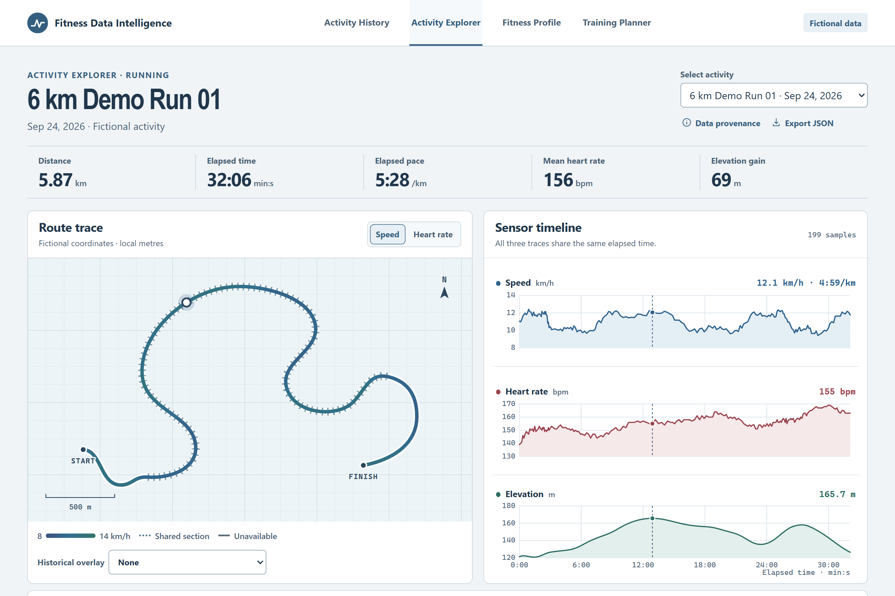
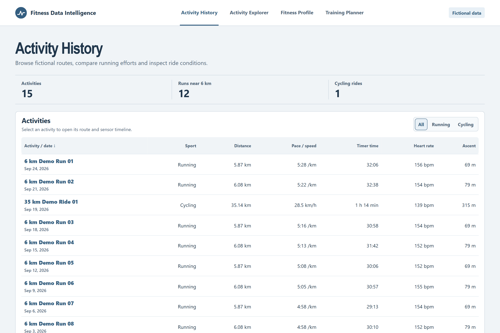
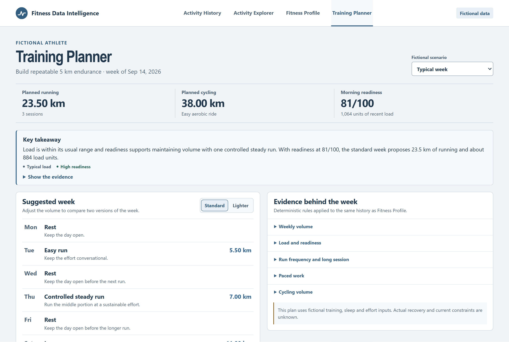

# Fitness Data Intelligence

Fitness Data Intelligence grew out of my experience as an avid runner and cyclist who wanted more meaningful insight from the detailed activity data recorded by my Garmin watch, beyond conventional workout summaries. I developed it to explore how performance differs along comparable routes and how recorded sensor measurements can be interpreted in context. It combines geospatial activity analysis, time-series processing, and environmental context to support evidence-based performance comparisons.

**Portfolio scope** — This standalone demonstration uses reproducible fictional routes, weather and athlete history. The route coordinates are local metres on a synthetic grid. The demo runs on loopback without a mapping account or internet connection.

## Run locally

Requires Python 3.10 or newer. The app uses the Python standard library and browser-native JavaScript and SVG.

```powershell
py -3.12 app.py serve --port 8000
```

On Linux or macOS, substitute `python3` for `py -3.12`. Open [the local application](http://127.0.0.1:8000/).

## Explore the demo

### Activity Explorer



Open **6 km Demo Run 01**. Select a point on the route, hover or drag across a sensor trace, or use the arrow keys on the sample slider. Route position, speed, heart rate and elevation follow the same sample. Switch the map colouring between speed and heart rate, or overlay a comparable route.

Compare a 6 km run against the same-route peer median or select a peer to inspect an aligned segment. Open the fictional 35 km ride to examine grade, wind and the steepest supported 500 m window.

### Activity History



Filter by running or cycling and sort by distance, pace or speed, timer time, heart rate, or ascent to compare activity summaries. Select an activity to open its route and signals in Activity Explorer.

### Fitness Profile


Inspect benchmark and training-volume trends alongside fictional heart-rate variability, resting heart rate and sleep. Change the scenario to see how the inputs affect the illustrative readiness score.

### Training Planner



Compare two versions of the same proposed week and open the evidence behind the sessions and distance budgets. The planner uses deterministic rules based on recent training load and the selected scenario.

The Profile and Planner share a separate 36-week fictional history. The sample exports cover the two original synthetic runs. Their CSV and JSON contain source signals, derived units and quality flags.

## Methods and limitations

- [Data and numerical methods](docs/data-methods.md) documents the seeded fixture, conversions, coverage, gaps and hand-checkable numerical examples.
- [Comparative methods](docs/comparative-methods.md) explains same-direction geometric matching, shared-distance bins and wind components.
- [Health and training methods](docs/health-methods.md) documents load windows, the illustrative readiness formula and the planning guard.
- [Semantic interpretation](docs/semantic-methods.md) documents the descriptive thresholds and why evidence is withheld for insufficient coverage.

The demo computes metrics, generates takeaways and proposes training sessions using deterministic rules with inspectable evidence. AI-assisted interpretation is a future direction. The weather and health figures are illustrations. The readiness estimate and proposed sessions are demonstration outputs without clinical or coaching validation.

## Tests and exports

```powershell
py -3.12 -m unittest discover -s tests -v
node --test tests/test_comparison_map.mjs
py -3.12 app.py export --output artifacts/exports
```

The Python suite includes numerical, synthetic-data and loopback HTTP tests. The Node test checks how overlapping markers are rendered in a matched-route comparison.
